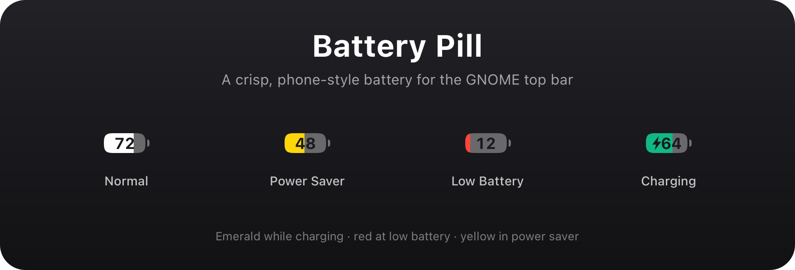
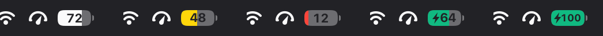
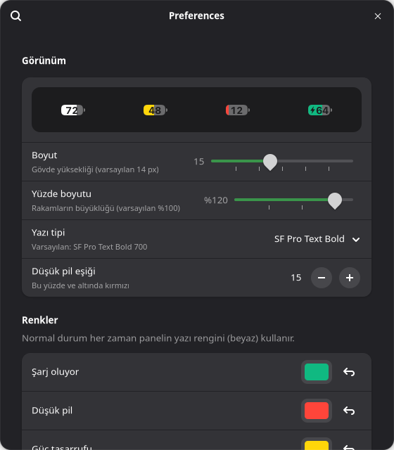

<p align="center"></p>

**Battery Pill** replaces the GNOME top-bar battery icon with a crisp, phone-style battery pill. The percentage sits inside the pill, and the color tells you the state at a glance.

<p align="center"></p>

## Install

One command, user level, no sudo:

```bash
curl -fsSL https://raw.githubusercontent.com/ensignalp/battery-pill/main/install.sh | bash
```

Then **log out and back in**, because Wayland only loads new extensions at login.

| Option | What it does |
|---|---|
| `… \| bash -s -- --sf-pro` | Also downloads **SF Pro Text** from Apple for the default font (needs `7zip` + `cpio`; Apple's font license applies) |
| `… \| bash -s -- --uninstall` | Removes the extension; the built-in battery icon comes back |

From a clone: `git clone https://github.com/ensignalp/battery-pill && cd battery-pill && ./install.sh`

Requires GNOME Shell **49, 50 or 51** and a laptop battery reported by UPower. On desktops without a battery it stays out of the way.

## States

The fill color follows a strict priority, so overlapping states never fight:

| Priority | State | Look |
|:-:|---|---|
| 1 | Charging, full on AC, or held by a charge limit | **Emerald** + bolt |
| 2 | Battery at or below 15 % (adjustable) | **Red** |
| 3 | Power Saver profile active | **Yellow** |
| 4 | Everything else | **White** (follows the panel text color) |

Charging always wins, so you get green with a bolt even in Power Saver. Low battery beats Power Saver because GNOME switches Power Saver on automatically when the battery runs low; red still shows exactly when it matters.

## Settings



- **Size**: body height from 10 to 22 px, keeping the same proportions at every size.
- **Percentage size**: 60–130 % of the default. The digits shrink automatically if needed so they never spill out of the pill.
- **Font**: SF Pro Text Bold 700 (default) or the system font. If SF Pro Text is not installed, it falls back to the system font automatically.
- **Low battery threshold**: 5–30 %.
- **Colors** for charging, low battery and power saver.
- **Hide the built-in battery icon**: on by default; turn it off to compare both side by side.

Open with `gnome-extensions prefs battery-pill@ensignalp`. The settings UI is currently in Turkish.

<br clear="right">

## How it works

- **Event-driven.** It listens to UPower (`DisplayDevice`) and power profiles (`power-profiles-daemon` or `tuned-ppd`) over D-Bus. There are no timers or polling. It also survives daemon restarts.
- **Sharp at any scale.** The pill is drawn with Cairo and snapped to the device-pixel grid. That covers 100/125/150/200 % and fractional scaling. Corners are continuous ("squircle"). The digits are knocked out of the fill, so they stay readable in every color.
- **Smooth.** Level and color changes ease in over about 0.4 s. It respects the GNOME "reduce animations" setting.
- **Clean takeover.** It hides only the built-in panel battery icon and restores it exactly when disabled. The Quick Settings battery entry is left alone.
- **Lock screen.** It also shows on the lock screen.

## Development

```bash
make link      # symlink this checkout into ~/.local/share/gnome-shell/extensions (log out/in once)
make test      # pure unit tests (state priority, geometry/pixel snapping) via gjs
make preview   # render every state at several sizes/scales → /tmp/bp-preview.png
make shot      # screenshot the real extension in an isolated headless GNOME Shell
make logs      # follow gnome-shell logs
make mock-on   # drive the pill from ~/.cache/bp-mock.json, e.g. {"percent":12,"state":2,"profile":"power-saver"}
make mock-off
```

`make shot` starts a separate headless `gnome-shell`, so it never touches your running session.

## Türkçe

GNOME üst paneli için yüzdesi içinde, telefon tarzı keskin bir pil göstergesi. Renk önceliği şöyle:

1. Şarjda **zümrüt yeşili** ve şimşek.
2. %15 ve altında **kırmızı**.
3. Güç tasarrufunda **sarı**.
4. Diğer durumlarda **beyaz**.

Kurmak için yukarıdaki tek komutu çalıştırıp oturumu kapatıp açman yeterli.

## License

MIT. SF Pro is not bundled. `--sf-pro` downloads it from Apple under Apple's license.
